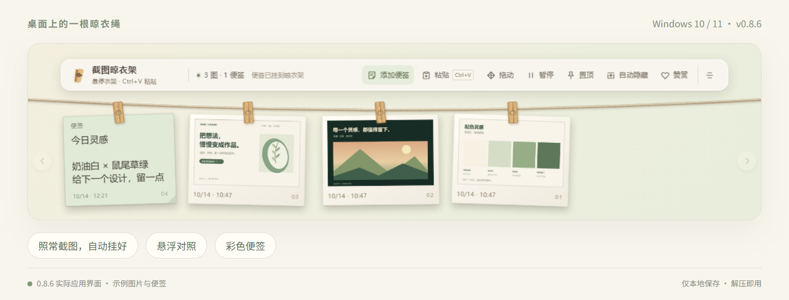
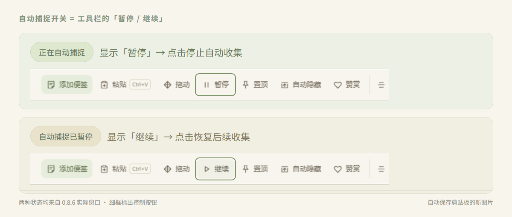
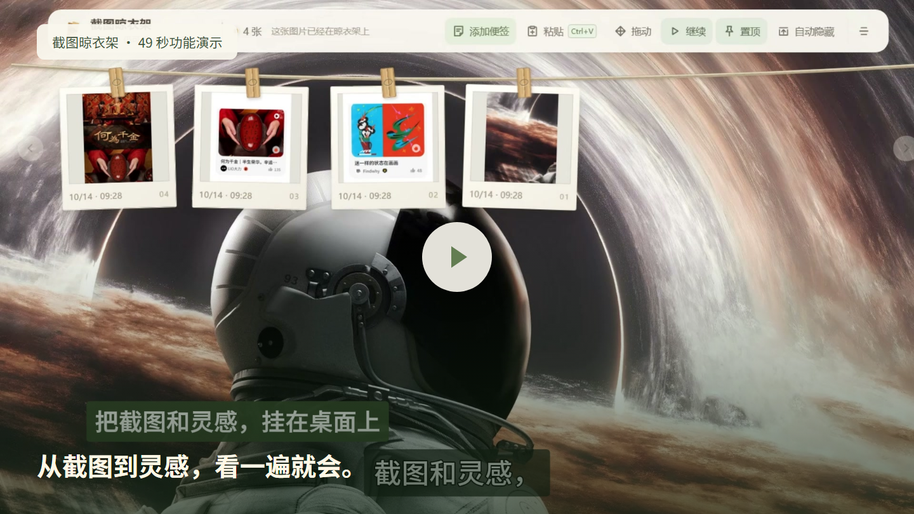
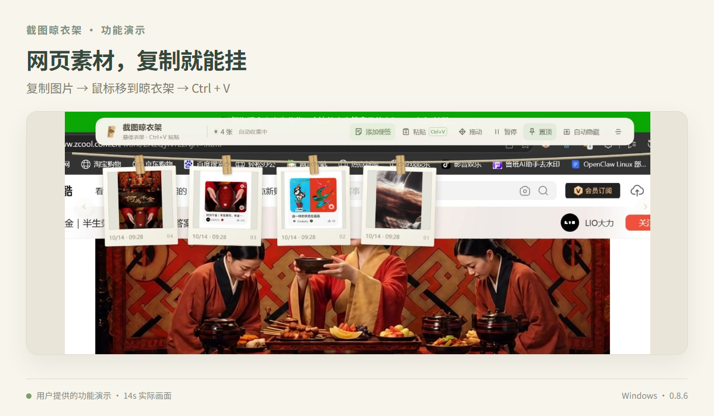
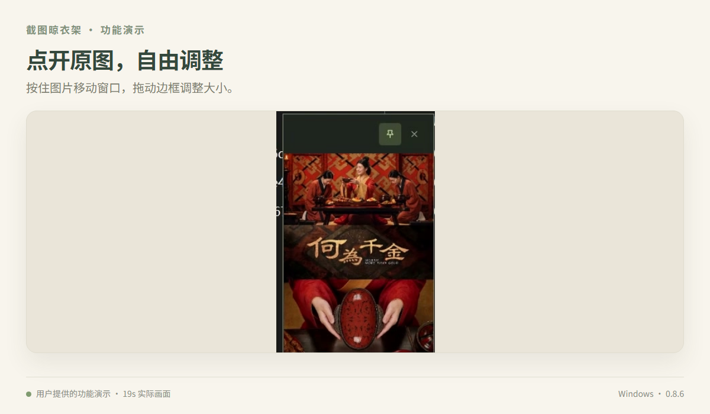
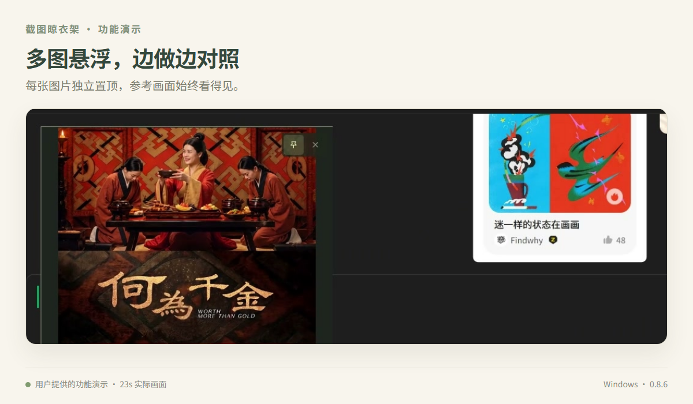
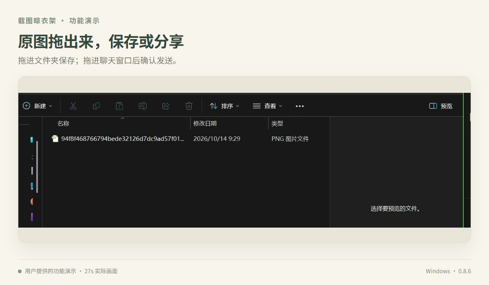
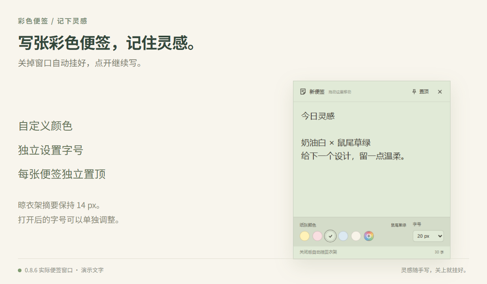
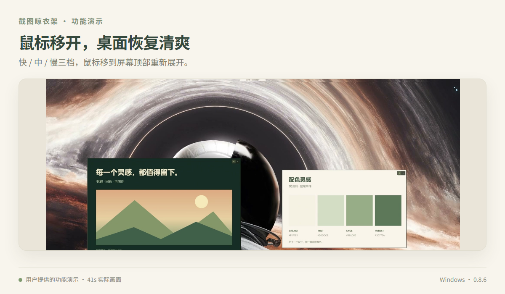

<p align="center">
  
</p>

<h1 align="center">截图晾衣架</h1>

<p align="center"><strong>截图和灵感，随手挂在桌面上。</strong></p>
<p align="center">自动挂图、悬浮对照、彩色便签，让需要的内容随时看得见。</p>

<p align="center">
  
  
  <a href="LICENSE"></a>
</p>

<p align="center">
  <a href="https://github.com/woxicaocao/screenshot-clothesline/releases/download/v0.8.6/screenshot-clothesline-0.8.6-win-x64.zip"><strong>下载免安装版</strong></a>
  · <a href="https://woxicaocao.github.io/screenshot-clothesline/showcase/#demo">观看演示</a>
  · <a href="#三步上手">快速上手</a>
</p>



把参考图挂在眼前，把临时想法写成便签。需要时展开，忙起来收起；桌面上多一根晾衣绳，少一点来回翻找。

## 1. 自动捕捉：照常截图，截完就挂上。

使用 Windows 或微信等截图工具截图后，**只要新图片进入剪贴板**，晾衣架就会自动保存并挂上。复制网页图片也可以自动收集。

**工具栏的「暂停 / 继续」，就是自动捕捉的开关。** 它控制是否自动收集剪贴板里的新图片；截图仍使用你熟悉的截图工具。



| 按钮显示 | 当前状态 | 点击后的效果 |
| :--- | :--- | :--- |
| **暂停** | 正在自动捕捉 | 停止自动收集新图片 |
| **继续** | 自动捕捉已暂停 | 恢复收集后续新图片 |

- **暂停后仍可手动挂图**：点击「粘贴」，或把鼠标移到展开的晾衣架上按 **Ctrl+V**。
- **启动或恢复时跳过旧内容**：当前剪贴板里已有的图片不会自动补挂；已有的重复图片也不会反复挂上。
- **想按需挑选网页素材**：先暂停，复制需要的图片后再手动粘贴。

## 2. 49 秒看懂怎么用

从截图挂上，到悬浮对照、拖出原图、添加便签和自动隐藏，跟着实际操作看一遍。

[打开在线详情，直接播放演示](https://woxicaocao.github.io/screenshot-clothesline/showcase/#demo) · 原片与配音完整保留。

[](https://woxicaocao.github.io/screenshot-clothesline/showcase/#demo)

[观看 / 下载完整演示视频](https://github.com/woxicaocao/screenshot-clothesline/releases/download/v0.8.6/%E6%88%AA%E5%9B%BE%E6%99%BE%E8%A1%A3%E6%9E%B6%E5%8A%9F%E8%83%BD%E6%BC%94%E7%A4%BA_0.8.6OK.mp4) · 横屏 16:9 · 使用实际操作录屏与配音

## 网页素材，复制就能挂

在 Chrome、Edge 等浏览器里右键 **复制图片**，把鼠标移到展开的晾衣架，按 **Ctrl+V**。不需要安装浏览器扩展。



如果自动捕捉正在运行，新图片可能已经自动挂上；再粘贴同一张不会重复添加。请选择「复制图片」，而不是「复制图片地址」。

## 点开原图，自由调整

点击小图打开原图。**按住图片移动窗口，拖动边框调整大小**，图片始终按比例适应窗口；滚轮还能同步缩放图片与窗口。细边框留出更多查看空间。



## 多图悬浮，边做边对照

右键图片选择 **悬浮**，多张图片可以各自打开、移动和置顶。设计参考、教程步骤、临时资料，都能放在工作窗口旁边。



每个图片窗口有自己的置顶开关；关闭窗口后，原图仍保留在晾衣架上。

## 原图拖出来，保存或分享

把图片从晾衣架拖进文件夹，保存一份原图；拖进微信等支持图片拖放的聊天窗口，再确认发送。



晾衣架显示小缩略图，预览和拖出使用保存的原图。网页图片的清晰度取决于复制到剪贴板的内容，建议复制网站大图。

## 写张彩色便签，记住灵感

点击 **添加便签**，直接输入文字。选一个喜欢的颜色，调整字号；关掉便签窗口，保存成功后就自动挂好了。



支持五种预设颜色与自定义颜色，多张便签可以同时打开和独立置顶。晾衣架上的摘要固定为 14px，窗口里的阅读字号可以单独调整。

## 鼠标移开，桌面恢复清爽

打开 **自动隐藏**，选择快、中、慢。鼠标离开晾衣架后，它会收起到屏幕顶部；把鼠标移到对应的顶部位置，又会重新展开。



| 档位 | 鼠标离开后的收起时间 |
| :--- | :--- |
| 快 | 立即 |
| 中 | 1 秒 |
| 慢 | 2 秒 |

已经打开的图片和便签继续留在桌面上。衣架收起时，它们仍可独立查看；开启置顶也不会阻止衣架自动隐藏。

## 三步上手

1. **下载并完整解压** [Windows x64 免安装 ZIP](https://github.com/woxicaocao/screenshot-clothesline/releases/download/v0.8.6/screenshot-clothesline-0.8.6-win-x64.zip)。
2. **双击「截图晾衣架.exe」**。无需安装 Node.js，程序旁边的文件请一起保留；如果旧版仍在运行，先从托盘退出旧版。
3. **照常截图，开始挂图**。也可以复制网页图片后手动粘贴，或点「添加便签」记录想法。

晾衣架可以拖动，宽度约为当前屏幕的 40%，支持横向翻看旧图片和便签。默认不置顶、自动隐藏默认关闭；按自己的习惯开启即可。

## 常见问题

<details>
<summary><strong>截图后没有挂上，先检查哪里？</strong></summary>

检查工具栏是否显示「继续」：这表示自动捕捉已暂停，点击即可恢复。截图工具需要把图片放到剪贴板；文字、文件路径和「复制图片地址」不会当作图片收集。

启动和恢复时会跳过剪贴板原有图片，请再截一张；如果要添加现有图片，点击「粘贴」或悬停按 Ctrl+V。重复图片不会重新挂出，保存失败时界面会提示原因。

</details>

<details>
<summary><strong>图片默认放在哪？重启后还在吗？</strong></summary>

原图默认保存在 `%APPDATA%\screenshot-clothesline\photos`，完整本地数据目录为 `%APPDATA%\screenshot-clothesline`。在资源管理器地址栏输入即可打开。

保存成功的图片、便签和设置会在重启后恢复。备份时先从托盘退出程序，再复制完整数据目录；升级时沿用旧数据。

</details>

<details>
<summary><strong>拖进微信会直接发送吗？</strong></summary>

拖进聊天窗口后，请检查接收对象和内容，再点击发送。目标程序需要支持图片或文件拖放；拖进文件夹会保存原图副本。

</details>

<details>
<summary><strong>会上传截图吗？能自己截图吗？</strong></summary>

截图、图片和便签仅保存在本机，不提供云同步。晾衣架负责收集和查看剪贴板图片，截图继续使用 Windows、微信或其他已有工具。

</details>

<details>
<summary><strong>怎样节省内存？</strong></summary>

衣架使用小缩略图，打开图片窗口时才加载原图。关闭暂时不用的大图和便签窗口，可以释放对应资源。占用随图片尺寸和同时打开的窗口数量变化，没有固定低于 100 MB 的保证。

</details>

<details>
<summary><strong>关闭窗口和删除有什么区别？</strong></summary>

关闭图片窗口只结束查看，照片仍保留。右键衣架上的图片或便签选择「删除」会永久移除对应内容；图片删除也会清理该图的本地缓存，无法撤销。

</details>

详细操作、数据备份和边界说明见 [完整使用手册](docs/使用手册.md)。

## 从源码运行

Windows 开发环境需安装 Node.js 与 npm。项目使用 Electron 44.7.0、原生 HTML / CSS / SVG 和 electron-builder 26.15.3。

```powershell
npm ci
npm start
```

检查与构建：

```powershell
npm test
npm run smoke
npm run smoke:notes
npm run smoke:appreciation
npm run dist
```

构建输出位于 `release/v0.8.6`。自动化 smoke 使用隔离数据；微信与资源管理器的实际拖放、不同系统显示设置仍需在日常环境验证。已有验证记录见 [0.8.6 验证说明](docs/verification-v0.8.6.md)。

## 反馈与参与

遇到问题或有想法，欢迎 [提交 Issue](https://github.com/woxicaocao/screenshot-clothesline/issues)。请尽量附上软件版本、Windows 版本、显示缩放、复现步骤与相关截图，帮助定位。

开发参与方式见 [贡献说明](CONTRIBUTING.md)。程序源码采用 [MIT 许可证](LICENSE)；依赖与演示中第三方作品保留各自的许可和权利。

<details>
<summary>赞赏</summary>

如果截图晾衣架对你有帮助，可以自愿赞赏，感谢支持。

<p></p>

</details>
