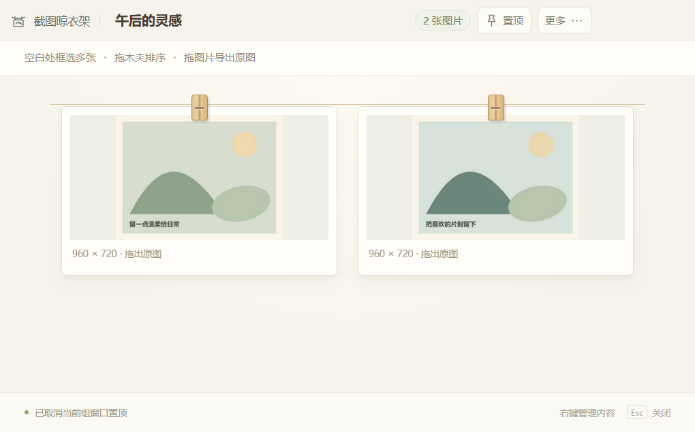
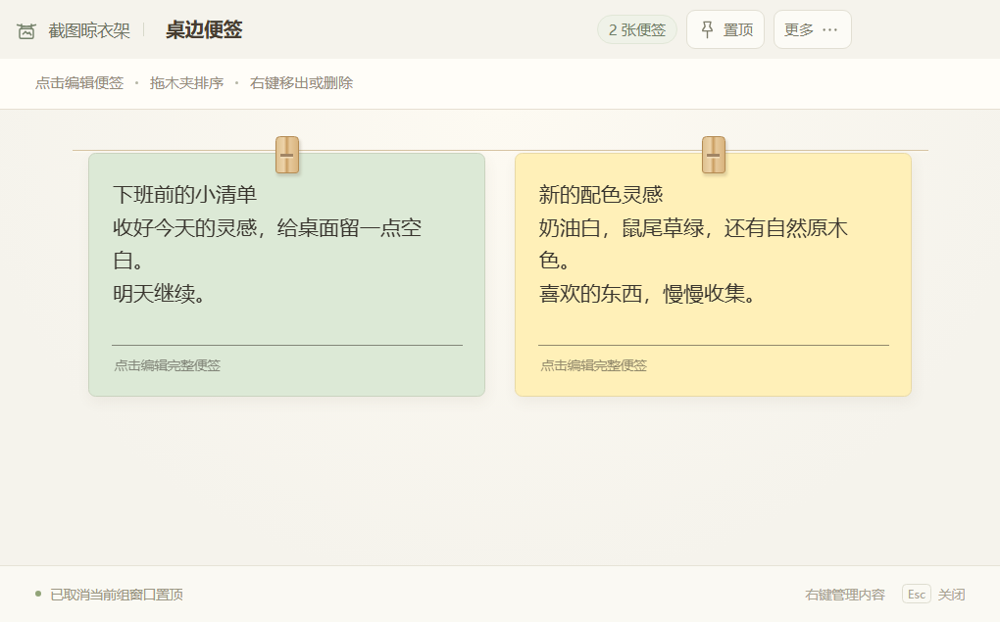
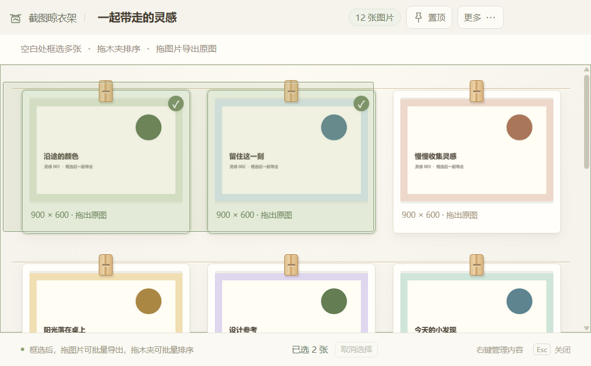
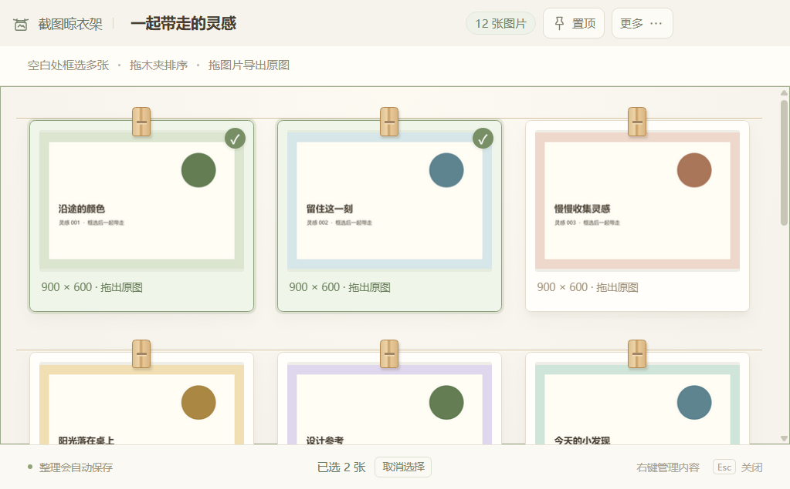
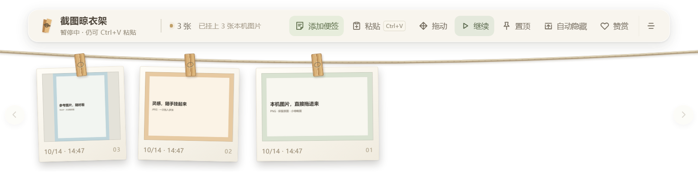
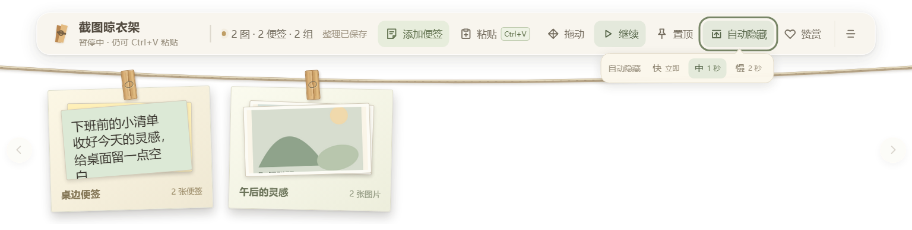

<p align="center">
  
</p>

<h1 align="center">截图晾衣架</h1>

<p align="center"><strong>截图和灵感，随手挂在桌面上。</strong></p>
<p align="center">自动挂图、悬浮对照、彩色便签，让需要的内容随时看得见。</p>

<p align="center">
  
  
  <a href="LICENSE"></a>
</p>

<p align="center">
  <a href="https://github.com/woxicaocao/screenshot-clothesline/releases/download/v0.8.8-beta.4/screenshot-clothesline-0.8.8-beta.4-win-x64.zip"><strong>下载免安装测试版</strong></a>
  · <a href="https://woxicaocao.github.io/screenshot-clothesline/showcase/#demo">观看演示</a>
  · <a href="#三步上手">快速上手</a>
</p>


把参考图挂在眼前，把临时想法写成便签。需要时展开，忙起来收起；桌面上多一根晾衣绳，少一点来回翻找。

**0.8.8-beta.4 已开放下载**：木夹整理、同类分组、图片组框选与批量拖动，让一根晾衣绳也能装下成套参考。[查看本次更新](docs/release-v0.8.8-beta.4.md) · [更新记录](CHANGELOG.md)

## 1. 自动捕捉：照常截图，截完就挂上。

使用 Windows 或微信等截图工具截图后，**只要新图片进入剪贴板**，晾衣架就会自动保存并挂上。复制网页图片也可以自动收集。

**工具栏的「暂停 / 继续」，就是自动捕捉的开关。** 它控制是否自动收集剪贴板里的新图片；截图仍使用你熟悉的截图工具。


| 按钮显示 | 当前状态 | 点击后的效果 |
| :--- | :--- | :--- |
| **暂停** | 正在自动捕捉 | 停止自动收集新图片 |
| **继续** | 自动捕捉已暂停 | 恢复收集后续新图片 |

- **暂停后仍可手动挂图**：点击「粘贴」，或把鼠标移到展开的晾衣架上按 **Ctrl+V**。
- **启动或恢复时跳过旧内容**：当前剪贴板里已有的图片不会自动补挂；已有的重复图片也不会反复挂上。
- **想按需挑选网页素材**：先暂停，复制需要的图片后再手动粘贴。

## 2. 49 秒看懂怎么用

从截图挂上，到悬浮对照、拖出原图、添加便签和自动隐藏，跟着实际操作看一遍。视频录制于 **0.8.6**，展示基础用法；本次新增的分组与批量操作见下方图文。

[打开在线详情，直接播放演示](https://woxicaocao.github.io/screenshot-clothesline/showcase/#demo) · 原片与配音完整保留。

[](https://woxicaocao.github.io/screenshot-clothesline/showcase/#demo)

[观看 / 下载完整演示视频](https://github.com/woxicaocao/screenshot-clothesline/releases/download/v0.8.6/screenshot-clothesline-demo-0.8.6OK.mp4) · 横屏 16:9 · 使用实际操作录屏与配音

## 一根绳子，也能分门别类

**拖木夹整理，拖图片带走原图。** 图片、便签和组卡都能左右调整位置；插入线标出松手后的顺序，靠近衣架两端会自动滚动。

想把相关内容放在一起，就拖住木夹，移到另一张**同类卡片中央停留约 350 毫秒**，看到「松手成组」再松开。新图片可以继续加入图片组，新便签可以继续加入便签组。图片与便签分开收纳；组卡可以排序，不嵌套，也不互相合并。



点击组卡，在衣架下方打开独立浏览窗口。默认三列，窄窗口自动减少列数，内容多时上下滚动。组名、数量、**独立置顶**和「更多」收进同一条紧凑标题栏，为内容留下更多空间。

图片组点击看原图；便签组点击继续编辑。便签摘要固定 **14px**，保留纸张颜色，与编辑窗口的字号分别设置。组窗口切换时复用，关闭后销毁；图片和便签仍可同时打开多个窗口。



| 想做什么 | 操作 | 内容会怎样 |
| :--- | :--- | :--- |
| 换个名字 | 右键组 → 重命名，或编辑窗口顶部组名 | 保留内容与顺序 |
| 单独拿出来 | 右键组内成员 → 移出此组 | 放回原组右侧 |
| 把一组展开 | 右键组 → 解散组 | 按组内顺序回到衣架 |
| 删除整组内容 | 右键组 → 删除整个组，再确认 | 永久删除程序保存的组内内容及对应缓存 |

组内只剩一项时自动还原为普通卡片，空组自动取消。**「解散组」保留内容，「删除整个组」不可撤销**；整组删除只处理晾衣架保存的副本，拖入前的本机源文件不受影响。

## 框起来，一起整理或带走

在**图片组的空白处**按住鼠标左键，拖出矩形，就能选中多张图片。靠近浏览区上下边缘会继续滚动，选中的图片有清晰标记与数量提示。



| 手势 | 效果 |
| :--- | :--- |
| Ctrl + 点击 | 增加或取消单张选择 |
| Shift + 点击 | 按组内顺序连续选择；Ctrl + Shift 可追加范围 |
| Ctrl+A | 全选当前图片组 |
| Esc / 取消选择 | 清空选择；拖动中先取消本次拖动 |
| 拖选中图片的木夹 | 整批调整组内顺序，保留所选图片之间的先后顺序 |
| 拖选中图片的主体 | 把所选原图一起拖到文件夹或支持多文件拖放的程序 |



一次最多批量拖动 **100 张**，超过会明确提示，不会漏掉图片。排序保存失败时保留原顺序与选择，修正后可重试；取消拖动或原图准备失败不会误开图片。选择仅在当前图片组窗口临时保留，切换组或关闭窗口后清空。便签组继续使用单项整理和编辑。

拖到微信后仍需检查对象与附件，再确认发送。目标程序必须支持相应图片格式和多文件拖放，实际接收方式由它决定。

## 本机图片，拖进来就挂

从资源管理器选中图片，拖到展开的晾衣架上的工具栏、绳子或卡片区域，松开即可添加。可以一次拖入多张 **PNG、JPG/JPEG、WebP** 图片；自动捕捉暂停时也能使用。



导入保存独立副本，文件夹里的原文件保留。衣架显示小缩略图，预览和拖出使用原图，保留导入文件的编码、尺寸与内容。重复图片只保留一张；不支持的格式或保存失败会提示，可修正后重新拖入。

## 网页素材，复制就能挂

在 Chrome、Edge 等浏览器里右键 **复制图片**，把鼠标移到展开的晾衣架，按 **Ctrl+V**。不需要安装浏览器扩展。


如果自动捕捉正在运行，新图片可能已经自动挂上；再粘贴同一张不会重复添加。请选择「复制图片」，而不是「复制图片地址」。

## 点开原图，自由调整

点击小图打开原图。**按住图片移动窗口，拖动边框调整大小**，图片始终按比例适应窗口；滚轮还能同步缩放图片与窗口。细边框留出更多查看空间。


## 多图悬浮，边做边对照

右键图片选择 **悬浮**，多张图片可以各自打开、移动和置顶。设计参考、教程步骤、临时资料，都能放在工作窗口旁边。


每个图片窗口有自己的置顶开关；关闭窗口后，原图仍保留在晾衣架上。

## 原图拖出来，保存或分享

把图片从晾衣架拖进文件夹，保存一份原图；拖进微信等支持图片拖放的聊天窗口，再确认发送。


晾衣架显示小缩略图，预览和拖出使用保存的原图。网页图片的清晰度取决于复制到剪贴板的内容，建议复制网站大图。

## 写张彩色便签，记住灵感

点击 **添加便签**，直接输入文字。选一个喜欢的颜色，调整字号；关掉便签窗口，保存成功后就自动挂好了。


支持五种预设颜色与自定义颜色，多张便签可以同时打开和独立置顶。晾衣架上的摘要固定为 14px，窗口里的阅读字号可以单独调整。

新便签会优先打开在衣架下方，留出间距；空间不足时尝试其他方向并缩小，避免盖住衣架。多张新便签错开标题栏，已有便签重新打开时沿用保存的位置。

## 鼠标移开，桌面恢复清爽

打开 **自动隐藏**，把鼠标停在该按钮上约 **0.5 秒**，才展开快、中、慢设置；移开按钮与设置面板后，选项会收起。鼠标离开晾衣架后，它会收起到屏幕顶部；把鼠标移到对应的顶部位置，又会重新展开。




| 档位 | 鼠标离开后的收起时间 |
| :--- | :--- |
| 快 | 立即 |
| 中 | 1 秒 |
| 慢 | 2 秒 |

已经打开的图片、便签和组窗口继续留在桌面上，开启独立置顶也不会阻止衣架自动隐藏。木夹整理、框选和拖入期间暂时保持展开，结束或取消后恢复。

## 三步上手

1. **下载并完整解压** [Windows x64 免安装测试版 ZIP](https://github.com/woxicaocao/screenshot-clothesline/releases/download/v0.8.8-beta.4/screenshot-clothesline-0.8.8-beta.4-win-x64.zip)。
2. **双击「截图晾衣架.exe」**。无需安装 Node.js，程序旁边的文件请一起保留；如果旧版仍在运行，先从托盘退出旧版。
3. **照常截图，开始挂图**。也可以从文件夹拖入本机图片、复制网页图片后手动粘贴，或点「添加便签」记录想法。

晾衣架可以拖动，宽度约为当前屏幕的 40%。整个卡片浏览区域都能用滚轮左右翻看，包含卡片之间的间隙；区域之外的透明空白继续点击穿透。默认不置顶、自动隐藏默认关闭；按自己的习惯开启即可。

## 常见问题

<details>
<summary><strong>本机图片怎样添加？会移动或删除原文件吗？</strong></summary>

先展开衣架，从文件夹选中静态 PNG、JPG/JPEG 或 WebP 图片，拖到工具栏、绳子或卡片区域后松开。可多选；导入只保存副本，不修改、移动或删除来源文件。GIF、BMP、SVG、动态 PNG/WebP、文件夹和网页链接暂不支持直接拖入，请转换为支持的静态格式。

</details>

<details>
<summary><strong>截图后没有挂上，先检查哪里？</strong></summary>

检查工具栏是否显示「继续」：这表示自动捕捉已暂停，点击即可恢复。截图工具需要把图片放到剪贴板；文字、文件路径和「复制图片地址」不会当作图片收集。

启动和恢复时会跳过剪贴板原有图片，请再截一张；如果要添加现有图片，点击「粘贴」或悬停按 Ctrl+V。重复图片不会重新挂出，保存失败时界面会提示原因。

</details>

<details>
<summary><strong>图片默认放在哪？重启后还在吗？</strong></summary>

原图默认保存在 `%APPDATA%\screenshot-clothesline\photos`，完整本地数据目录为 `%APPDATA%\screenshot-clothesline`。在资源管理器地址栏输入即可打开。

保存成功的图片、便签、分组、顺序和设置会在重启后恢复。`layout.json` 只保存排序、组名和成员引用，不复制原图或便签正文，也不改变原有索引格式。备份时先从托盘退出程序，再复制完整数据目录；升级时沿用旧数据。建议升级前备份，不要单独删除或替换索引文件。

</details>

<details>
<summary><strong>拖进微信会直接发送吗？</strong></summary>

拖进聊天窗口后，请检查接收对象和内容，再点击发送。目标程序需要支持图片或文件拖放；拖进文件夹会保存原图副本。

</details>

<details>
<summary><strong>会上传截图吗？能自己截图吗？</strong></summary>

截图、图片和便签仅保存在本机，不提供云同步。晾衣架负责收集和查看剪贴板图片，截图继续使用 Windows、微信或其他已有工具。

</details>

<details>
<summary><strong>怎样节省内存？</strong></summary>

衣架使用小缩略图，打开图片窗口时才加载原图。关闭暂时不用的大图和便签窗口，可以释放对应资源。占用随图片尺寸和同时打开的窗口数量变化，没有固定低于 100 MB 的保证。

</details>

<details>
<summary><strong>关闭窗口和删除有什么区别？</strong></summary>

关闭图片或组窗口只结束查看，内容仍保留。右键图片或便签选择「删除」会永久移除对应内容；图片删除也会清理该图在晾衣架中的原图与缓存。组的「移出此组」「解散组」都保留内容；「删除整个组」需要再次确认，并永久删除组内保存内容及对应缓存，无法撤销。拖入前的本机源文件不受影响。

</details>

详细操作、数据备份和边界说明见 [完整使用手册](docs/使用手册.md)。

## 从源码运行

Windows 开发环境需安装 Node.js 与 npm。项目使用 Electron 44.7.0、原生 HTML / CSS / SVG 和 electron-builder 26.15.3。

```powershell
npm ci
npm start
```

检查与构建：

```powershell
npm test
npm run smoke
npm run smoke:notes
npm run smoke:appreciation
npm run smoke:local-images
npm run smoke:organize
npm run smoke:group-refresh
npm run smoke:compact-hover
npm run smoke:batch-group
npm run dist -- --publish never
```

当前 `package.json` 的构建输出位于 `release/v0.8.8-beta.4`。构建只生成本地文件，发布由维护者另行处理。

本次发布保留既有测试记录：**247 项单元测试、最终程序 19 项批量专项和 54 项整理／导入／组管理／悬停回归通过**。自动化 smoke 使用隔离数据；批量拖出验证完整原图载荷与文件字节，微信、资源管理器等程序的真实 OLE 接收效果和实际跨显示器操作仍需人工确认。未重新测量内存峰值。详见 [0.8.8-beta.4 验证说明](docs/verification-public-v0.8.8-beta.4.md)。

## 反馈与参与

遇到问题或有想法，欢迎 [提交 Issue](https://github.com/woxicaocao/screenshot-clothesline/issues)。请尽量附上软件版本、Windows 版本、显示缩放、复现步骤与相关截图，帮助定位。

开发参与方式见 [贡献说明](CONTRIBUTING.md)。程序源码采用 [MIT 许可证](LICENSE)；依赖与演示中第三方作品保留各自的许可和权利。

<details>
<summary>赞赏</summary>

如果截图晾衣架对你有帮助，可以自愿赞赏，感谢支持。

<p></p>

</details>
